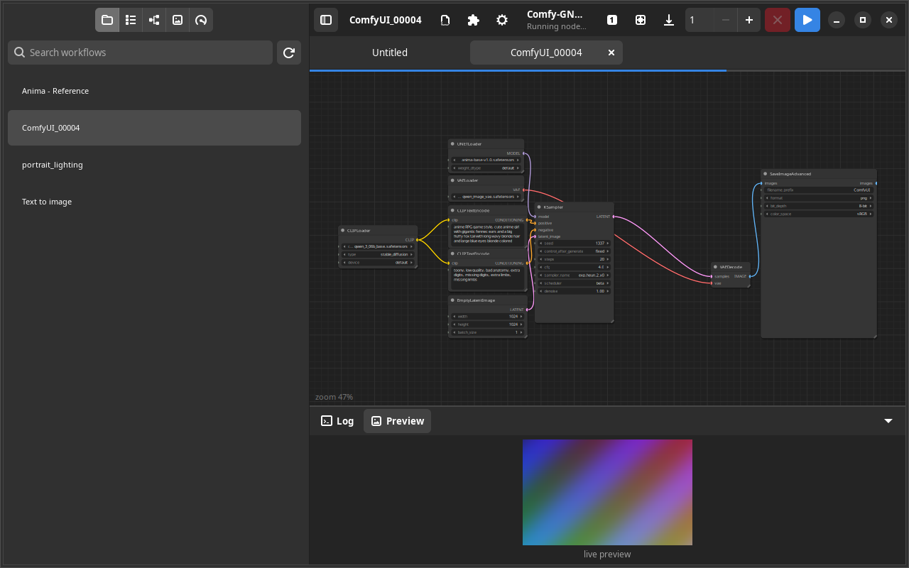
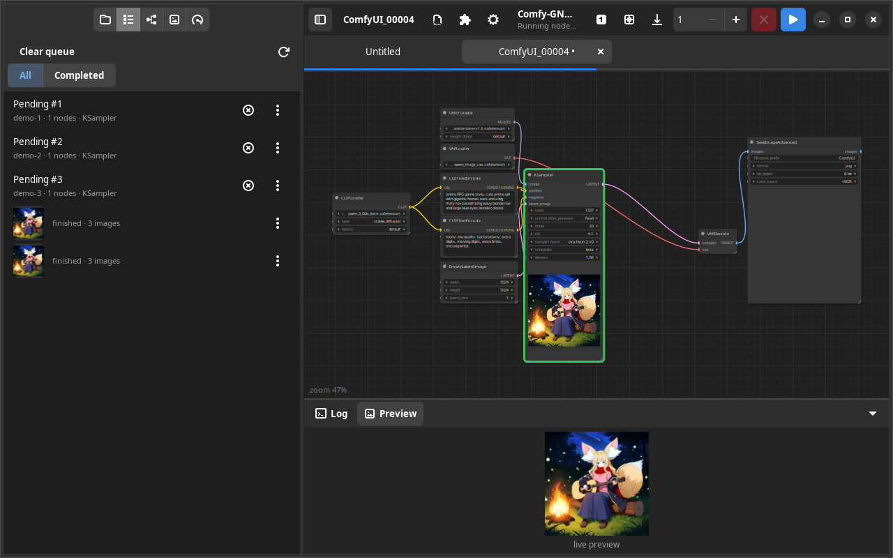

<p align="center">
  
</p>

<h1 align="center">Comfy-GNOME</h1>

<p align="center">A native GTK4 / libadwaita frontend for <a href="https://github.com/comfyanonymous/ComfyUI">ComfyUI</a>, written in Rust.</p>

<p align="center"><b>0.2.0-beta.1</b> — beta: fixes and features land fast, saved workflows stay compatible.
See <a href="CHANGELOG.md">CHANGELOG.md</a>.</p>

<p align="center"></p>

The graph lives in one immediate-mode cairo canvas instead of a web view: pan, zoom and node dragging cost no
GPU time, the UI stays responsive on an integrated GPU while ComfyUI renders, and workflows load straight from
the backend's `userdata` folder.

## What it does

- **Launch or attach** — pick your ComfyUI folder and the app runs `main.py` with its `venv` (and stops the server
  when it quits), or attach to a ComfyUI already running elsewhere. Browser-opening scripts are blocked.
- **Graph editing** — open saved workflows in tabs, colour-coded typed wires, move/wire/de-anchor nodes,
  multi-select and rubber band, add/duplicate/delete/collapse/bypass/mute, groups you can create, rename,
  recolour, drag and delete.
- **Widgets in place** — numbers, combos, text, toggles, seeds with `control_after_generate`, subgraph-promoted
  widgets, rgthree Power Lora / Fast Groups Bypasser, and tag-cloud widgets from custom-node packs.
  Every widget row carries its input socket: drag from the dot to feed the parameter a wire.
- **Node resize and snap to grid** — drag the bottom-right grip; positions and sizes snap to
  `Comfy.SnapToGrid.GridSize` while Shift is held or `pysssss.SnapToGrid` is on.
- **Subgraphs** — drill in with a breadcrumb, rename the definition (every instance re-titles, like the web UI),
  clear a subgraph's workflow, `Esc` to go back.
- **Prompt editing** — a real text editor for prompt boxes: Ctrl+↑/↓ weights the word or selection
  `(word:1.05)`, Ctrl+Enter applies, Enter inserts a newline, long prompts wrap instead of scrolling out of sight.
- **Link Render Mode** — spline, straight, linear or hidden wires, live from Settings (`Comfy.LinkRenderMode`).
- **Row menus** — right-click any Power Lora row to toggle it, move it up/down or remove it.
- **Collapsible log** — the Log/Preview pane folds into a thin bar with the `▼`/`▲` toggle, and comes back with
  one click; the bar never disappears.
- **Node Library** — a sidebar page with the backend's 4 700-odd nodes: search across names, paths and
  descriptions, or browse the category tree; click a node to drop it in the middle of the canvas.
- **MTB media browser** — browse ComfyUI's `input/` and `output/` folders (subfolders included, the path is
  editable), a uniform thumbnail grid with a size slider, Ctrl+click / Ctrl+drag multi-select, drop a picture on
  the canvas (a ComfyUI image opens its embedded workflow, anything else becomes a preloaded Load Image node),
  right-click to show the file in your file manager or move the selection to the Trash.
- **Queue** — day-grouped finished runs with durations and thumbnails, All/Completed filter, clear queue, and any
  pending, running or finished job opens its workflow in a new tab.
- **Images** — previews on nodes and in the log pane, full-size lightbox with ←/→ stepping over a job's images,
  and a LoRA Manager window in the host browser's app mode.
- **Live previews + progress** — TAESD, Latent2RGB and auto follow the server's Preview method setting. Frames
  land on the node the backend names as the display node — KSampler, SamplerCustom, or a custom sampler inside a
  subgraph — and the log pane shows the same image. A thin progress strip under the workspace tabs tracks the
  running sampler.
- **Templates** — the backend's template list (categories, search, All / Node graph / Apps) to start from.
- **Settings** — the same categories and keys as the ComfyUI frontend, read from the backend's own setting
  definitions, searchable, with icons.
- **Properties panel** — the toolbar's panel toggle opens the right sidebar for the selected node: Parameters
  (INPUTS / ADVANCED INPUTS, per-row Rename, Show input, Reset to default), Info (description and Inputs / Outputs
  tables) and Settings (Normal / Bypass / Mute, the ten node colours, Pinned). Subgraph instances get the editor
  instead: visible inputs with an eye each, and the hidden parameters of every inner node behind "Show all".
- **Faithful saving** — writes back to `userdata` preserving everything the editor does not model: an untouched
  open → save leaves the file byte-identical.

<p align="center"></p>

## Requirements

- Linux with X11 (Wayland works through XWayland)
- GTK ≥ 4.14 and libadwaita ≥ 1.5 development packages
- Rust (stable) and `cargo`
- A ComfyUI checkout (the app starts it for you)

## Run

```sh
./launch-system.sh             # native release build; rebuilds when sources change
./launch-flatpak.sh            # Flatpak (GNOME 50 runtime + rust-stable SDK); installs on first run
                               # and rebuilds by itself when the sources are newer than the last build
./launch-flatpak.sh --rebuild  # force a rebuild + reinstall
cargo run                      # debug build for development
```

On the splash screen pick your ComfyUI folder (auto-detected in `~/ComfyUI`, `~/Documents/ComfyUI`, …) and press
**Launch ComfyUI**, or **Skip** to attach to a backend that is already up. In the Flatpak, ComfyUI is started on
the host through `flatpak-spawn --host`.

The app passes its **Port** setting to launch scripts as well as folder launches, so a script must forward `"$@"`
to `main.py` when it sets its own port (the app's port wins). Closing the window stops the whole backend process
group, native or Flatpak — including a script's `python` and browser shim.

## Hotkeys

| Key | Action |
| --- | --- |
| Ctrl+Enter | Run |
| Ctrl+Shift+Enter | Run at front of queue (same as Shift+Run) |
| Ctrl+Alt+Enter | Interrupt |
| `.` | Fit view |
| Esc | Leave subgraph / close lightbox |
| Alt+C | Collapse selected nodes |
| Ctrl+B / Ctrl+M | Bypass / mute |
| Ctrl+G | Group selection |
| Ctrl+S | Save |
| Ctrl+, | Settings |
| Ctrl+↑/↓ | Weight the word or selection in a prompt |
| ←/→ or PgUp/PgDn | Step through a job's images in the lightbox |
| Shift-click | Add to selection (Shift when closing a tab skips the unsaved prompt) |
| Ctrl+click | Toggle a thumbnail in the MTB browser (Ctrl+drag draws a selection rectangle) |

## Development

```
src/main.rs            resources, adw::Application, window, Stack(splash → workspace)
src/splash.rs          launch configuration page
src/backend.rs         launch config, ComfyUI discovery/probe/spawn
src/workspace.rs       OverlaySplitView: sidebar | header + Paned(canvas / log)
src/canvas/mod.rs      the immediate-mode canvas
src/workflow.rs        workflow JSON parse/serialize, subgraph handling
src/settings_defs.rs   reads the backend's setting definitions
tools/demo/            mock ComfyUI backend used for the screenshots and UI work without models
```

`docs/ARCHITECTURE.md` has the design notes and the coordinate/geometry maths; `docs/TRANSLATION-NOTES.md`
lists what was adapted from Helvum and ComfyUI_frontend.

The screenshots above are taken in **dark mode** from the mock backend in `tools/demo` (`tools/demo/start.sh` starts a
fake ComfyUI on port 8198 plus an Xvfb display, and launches the app with `ADW_DEBUG_COLOR_SCHEME=prefer-dark`), so
nothing here needs model weights. The graph shown is `tools/demo/workflow.json`, the workflow embedded in a real
`ComfyUI_00004.png` (Anima: UNETLoader, CLIPLoader, VAELoader, KSampler, SaveImageAdvanced). The simulated result — on
the KSampler node, in the Preview pane and in the queue thumbnails — is that same image, downsized to `tools/demo/result.jpg`.

## Versioning

Semantic versions, tagged `vX.Y.Z`; `CHANGELOG.md` lists what changed in each one. Until `1.0.0` the app is in
beta, so a `0.x` release may change undocumented internals. The version in Settings → About comes from
`Cargo.toml`, so bump it there and tag the same commit.

## License

GPL-3.0-only. The canvas design is adapted from [Helvum](https://gitlab.freedesktop.org/pipewire/helvum)
(GPL-3.0-only) and the visual constants from ComfyUI_frontend / litegraph (GPL-3.0). Bundled symbolic icons in
`data/icons/` come from the Adwaita icon theme (CC-BY-SA 3.0 / LGPL-3.0).
